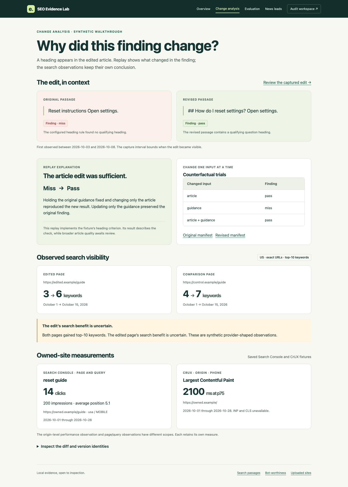
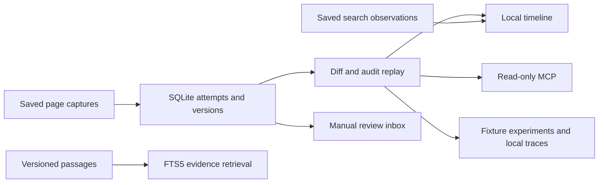

# SEO QA evidence replay
Compare two page captures, replay a versioned heading check, and inspect search visibility alongside the actual content change. This local demonstration uses synthetic publisher, article, performance, and competitor observations.



## Run the fixture walkthrough
With Python 3.12, a working SQLite build with FTS5, and a compatible wheel platform, run:

```sh
./walkthrough.sh
```

The first run installs pinned dependencies. Subsequent work reads local fixtures. See `demo-output/` for the comparison, source retrieval benchmark, local spans and evaluation results. To use the browser interface run `./run-local.command`, then open `/qa/competitors` at the printed loopback address. The source inbox accepts explicit local triage actions. Guidance publication and executable-rule activation require separate workflows.

[Watch the recorded local walkthrough](examples/walkthrough.webm) · [Retrieval measurements](examples/retrieval.json) · [Experiment comparison](examples/experiment-comparison.json)

## What to inspect
- **Capture history.** Four attempts produce two content versions. Repeated imports reuse the content hash. A timeout preserves the last good capture.
- **Finding replay.** The fixture heading criterion changes from miss to pass when the article changes. The comparison enumerates counterfactual combinations of article, guidance, scoring and evidence. Unknown scoring versions produce an unresolved result. This implementation covers the supplied heading criterion.
- **Visibility and first-party measurements.** Edited and comparison pages both gain top-ten keywords. The edit’s contribution to that gain is uncertain. The Search Console and CrUX examples retain scope and dates; missing measurements stay unknown.
- **Retrieval.** SQLite FTS5 returns ranked passages, source version and content hashes. Five of six fixed queries meet the top-three expectation. A paraphrase without lexical overlap misses its intended passage. Latencies and individual outcomes are in the sample report.
- **Evaluation and tooling.** Local dataset items and typed Jev request examples use simulated judgments. An actual stdio MCP server serves three read-only fixture tools. The browser, local OpenTelemetry exporter, property tests and CI command use disposable local data.
- **Product workflows.** The audit workspace includes five SEO scopes, site uploads and comparisons, reports, local history and separate Bot-worthiness review/revision/export flows.



## Verification
Run `./setup/fixture_ci.sh` after bootstrap. Browser verification uses installed Chrome and `python setup/local_acceptance.py --output PATH` from the local virtual environment. The portfolio capture script supports `--record` when the Playwright FFmpeg helper is installed. The manually triggered CI workflow is provided for future repository use.

**Failure case:** the earlier integrated app imported local-only modules that the historical hosted allowlist omitted. Packaging now refuses that composition before creating an archive. The fixture suite checks this boundary. The trace walkthrough deliberately requests a causal claim the timeline does not make; its failed assertion is captured locally for inspection.

**Future integrations:** actual provider access, real source review, account isolation and hosted acceptance require separate evidence. The included demo uses zero live Ahrefs, model or evaluation calls. No schedule is installed.

## Emerging news to reviewed guidance
The next integration connects the user's custom SEO/LLM-visibility news agent and research/scraper pipeline to this evidence trail. The local demo includes a [community lead review](NEWS-INTELLIGENCE.md) page at `/qa/community-news`. It preserves the difference between an emerging report, a source awaiting inspection, and approved guidance. Live Reddit and connected news ingestion remain future work.

## Origins
The original project inspiration was Sweepr's documentation-drift workflow, later adapted into SEO release verification. Botworthy Index subsequently informed the separate local quotability methodology. [Attribution and references](ATTRIBUTION.txt).
