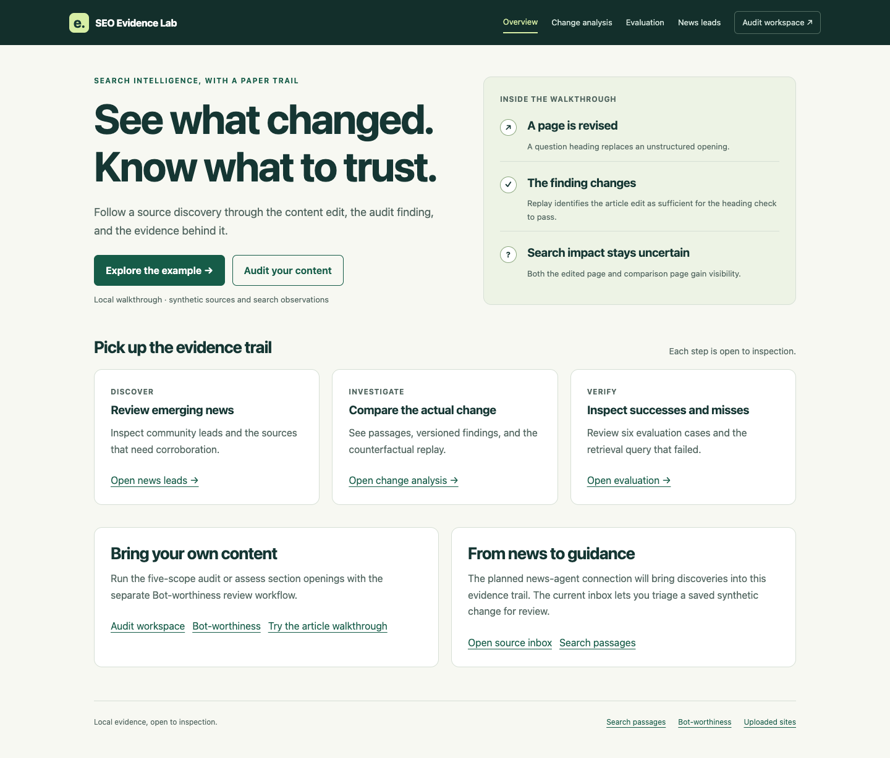
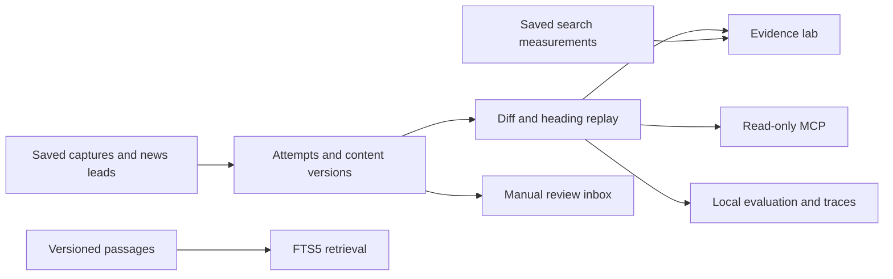

# SEO Evidence Lab
Explain why an SEO finding changed, with the original passage, edited content, versioned inputs, and replay results open to inspection.



This local Python application combines an SEO audit workspace with an inspectable synthetic change-analysis demo. The planned connection to a custom SEO/LLM-visibility news agent and research/scraper pipeline makes discovery the start of the evidence trail.

## What makes this project distinctive

The example asks whether a finding changed because the article, guidance, scoring logic, or evidence availability changed. It pins those four inputs and replays their combinations. This explains a deterministic finding; it does not establish that a page edit caused a search-performance improvement.

The evaluation screen exposes deliberately incorrect saved judgments and a retrieval paraphrase that misses its expected passage. The custom news/research bridge is the next milestone: move from a discovered claim to reviewed guidance, then identify affected findings. Saved-capture imports and the synthetic news journey work today; the live bridge is planned.

[Five-minute walkthrough](docs/DEMO-WALKTHROUGH.md) · [Architecture](docs/ARCHITECTURE.md) · [Evaluation results](docs/EVALUATION.md) · [Engineering case study](docs/CASE-STUDY.md) · [Roadmap](docs/ROADMAP.md)

## Try it locally
Use Python 3.12 with SQLite FTS5. Run the one-command walkthrough:

```sh
./walkthrough.sh
```

It installs the pinned local environment and writes reports to `demo-output/`. Choose the interpreter with `SEO_QA_BOOTSTRAP_PYTHON` if `python3.12` has a different name.

Then start the app:

```sh
./run-local.command
```

Open the printed address and choose **Evidence lab**. The main journey starts at `/qa/lab`.

- **Change analysis** puts the original passage, edit, finding and counterfactual trials together.
- **Evaluation** exposes the six-case results and the failed retrieval paraphrase.
- **News leads** separates an emerging report from its primary-source review.
- **Article walkthrough** uses the included publication-review article for a small-site owner. The editorial template remains blank.

[Recorded walkthrough](examples/walkthrough.webm) · [Evaluation screen](examples/evaluation.png) · [Current experiment report](examples/experiment-comparison.json) · [Retrieval benchmark](examples/retrieval.json)

## Inspect a claim
The edited synthetic page acquires a question heading. Replacing only the article makes the heading criterion pass. Updating only the guidance preserves the original finding. Both the edited page and comparison page gain synthetic top-ten keywords, so the edit’s search benefit remains uncertain.


The fixture replay covers a heading criterion. The broader five-scope audit and the separate Bot-worthiness assessment are available through the audit workspace. Old audits and edited-content assessments retain distinct identities.

## Technology and implemented scope
| Area | Local implementation |
| --- | --- |
| App | Python 3.12, FastAPI, Jinja2, responsive server-rendered pages |
| Evidence | SQLite attempt/version storage, content hashes, immutable replay inputs |
| Ingestion | Saved Firecrawl-shaped captures, Search Console and CrUX JSON imports, bounded synthetic subreddit observations |
| Search | SQLite FTS5, passage/source/version hashes, frozen six-query benchmark |
| Tools | Actual MCP stdio server with three read-only fixture tools |
| Evaluation | Three deterministic cases plus three simulated Jev-style judgments, Langfuse dataset-item exports |
| Observability | OpenTelemetry in-memory spans for comparison, import, failure, retry, diff and replay |
| Verification | pytest, Hypothesis, Playwright/Chrome, browser traces, real restart and export checks |
| Product | Five audit scopes, uploaded-site analysis, explanations, history, Bot-worthiness review/import/revision and exports |

The evaluation’s baseline is 4/6; revised canned answers reach 6/6. Those results test the harness. Real model performance and human labels remain pending. Retrieval meets five of six expectations; “slow user reactions” misses its intended passage. Every result is inspectable by case. The evaluation JSON binds the cases, saved judgments and implementation hashes.

## Reproduce verification
```sh
./setup/fixture_ci.sh
.venv/bin/python setup/iteration_one_browser.py --output local-ui-checks
.venv/bin/python setup/local_acceptance.py --output local-core-checks
```

Browser checks require installed Chrome. Optional `--record` on the UI script also requires the Playwright FFmpeg helper. Dependencies and browser artifacts remain outside source control.

The fixture CI workflow is prepared for manual execution after repository publication. Remote CI and hosted provider acceptance are pending. The source bootstrap has been exercised in a fresh extracted folder on macOS with Python 3.12.

## Architecture


## Engineering examples
- Packaging refused a local app whose new imports were absent from the historical hosted allowlist.
- Independent review caught request windows that contradicted the saved observations.
- Community payloads require explicit synthetic provenance, reject malformed source lists, and return detached source-link lists.
- Evaluation identity includes the simulated answers and executable source, so changing a canned answer changes the result identity.

[News/research integration design](NEWS-INTELLIGENCE.md) · [Capabilities and limits](CAPABILITIES.md) · [Release notes](RELEASE-NOTES.md) · [Contributing](CONTRIBUTING.md)

## Origins and publication
Sweepr’s documentation-drift workflow supplied the originating concept; Botworthy Index later informed the separate local quotability adaptation. [Attribution](ATTRIBUTION.txt).

The owner has signed off on the local MVP and six advisory source decisions. Two independent editorial reviews and empirical walkthrough observations have not been supplied; owner signoff does not create those results. The public destination is `j-zulick/seo-evidence-lab`. MIT is recommended for project-owned code; license adoption and publication await the owner’s final approval. See [license decision](LICENSE-DECISION.txt), [provenance](docs/PROVENANCE.md), and [dependency notices](THIRD-PARTY-NOTICES.md).

A separately authorized protected static preview demonstrates saved fixture evidence; it does not host the dynamic local app. Original production remains paused. Recurring collection and live rules are disabled, with zero live Ahrefs, model or evaluation calls in the demonstrated workflow. Public source publication does not require resuming application hosting. See [security and operating scope](SECURITY.md).
