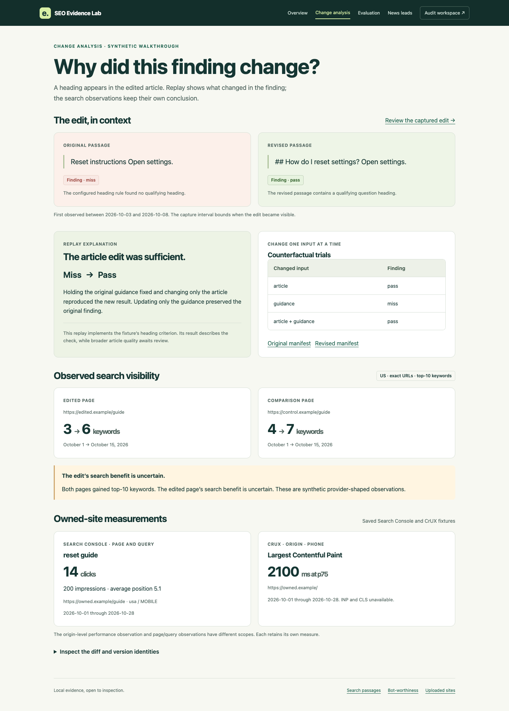
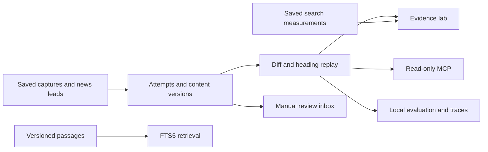

# SEO Evidence Lab

**Why did this SEO finding change?** In the sample audit, adding a question heading makes the article pass a heading check. Replaying the original article with updated guidance leaves the finding unchanged. Both the edited page and a comparison page gained synthetic search visibility, so the replay explains the audit result while the search impact remains uncertain.

[Follow the five-minute walkthrough](https://github.com/j-zulick/seo-evidence-lab/blob/v0.1.0/docs/DEMO-WALKTHROUGH.md) · [Inspect the replay data](https://github.com/j-zulick/seo-evidence-lab/blob/v0.1.0/examples/timeline.json) · [Download v0.1.0](https://github.com/j-zulick/seo-evidence-lab/releases/tag/v0.1.0)



## Run the released walkthrough

Use Git, Python 3.12 and SQLite with FTS5. In a new directory, run:

```sh
git clone --branch v0.1.0 --depth 1 https://github.com/j-zulick/seo-evidence-lab.git
cd seo-evidence-lab
./walkthrough.sh
./run-local.command
```

The walkthrough installs the pinned environment and writes reports to `demo-output/`. If Python 3.12 has a different executable name, set `SEO_QA_BOOTSTRAP_PYTHON` to its path. Open the address printed by the launcher and choose **Evidence lab** at `/qa/lab`. **Change analysis** lets you compare the passages and vary four inputs individually: article, guidance, scoring logic and available evidence. **Evaluation** shows the six saved cases and the paraphrase that missed its expected passage.

[Watch the recording](https://github.com/j-zulick/seo-evidence-lab/blob/v0.1.0/examples/walkthrough.webm) · [See the evaluation results](https://github.com/j-zulick/seo-evidence-lab/blob/v0.1.0/docs/EVALUATION.md) · [Review the release checks](https://github.com/j-zulick/seo-evidence-lab/actions/runs/42966824812)

## Current development

The default branch extends the released audit workspace with a saved news-agent inbox, source-bound proposals for guidance changes, expanded replay criteria, lexical retrieval and a read-only MCP server for a selected dataset. Reviewers can inspect proposed changes before activating guidance. Live collection and guidance publication await separate acceptance.

[Candidate instructions and verified limits](docs/V03-PREPARATION.md) · [Reproduce the saved-news bridge](docs/SAVED-NEWS-BRIDGE.md) · [Engineering case study](docs/CASE-STUDY.md) · [Architecture](docs/ARCHITECTURE.md) · [Roadmap](docs/ROADMAP.md)

## Technology and implemented scope
| Area | Local implementation |
| --- | --- |
| App | Python 3.12, FastAPI, Jinja2, responsive server-rendered pages |
| Evidence | SQLite attempt/version storage, content hashes, immutable replay inputs |
| Ingestion | Saved Firecrawl-shaped captures, Search Console and CrUX JSON imports, bounded synthetic subreddit observations |
| Search | SQLite FTS5, passage/source/version hashes, frozen six-query benchmark |
| Tools | Actual MCP stdio server with four read-only fixture tools, including faceted evidence search |
| Evaluation | Three deterministic cases plus three simulated Jev-style judgments, Langfuse dataset-item exports |
| Observability | OpenTelemetry in-memory spans for comparison, import, failure, retry, diff and replay |
| Verification | pytest, Hypothesis, Playwright/Chrome, browser traces, real restart and export checks |
| Product | Five audit scopes, uploaded-site analysis, explanations, history, Bot-worthiness review/import/revision and exports |

The evaluation’s baseline is 4/6; revised canned answers reach 6/6. Those results test the harness. Real model performance and human labels remain pending. Retrieval meets five of six expectations; “slow user reactions” misses its intended passage. Every result is inspectable by case. The evaluation JSON binds the cases, saved judgments and implementation hashes.

## Reproduce verification
```sh
./setup/fixture_ci.sh
.venv/bin/python setup/iteration_one_browser.py --output local-ui-checks
.venv/bin/python setup/local_acceptance.py --output local-core-checks
```

Browser checks require installed Chrome. Optional `--record` on the UI script also requires the Playwright FFmpeg helper. Dependencies and browser artifacts remain outside source control.

The manual fixture CI workflow passed on the exact v0.1.0 release commit in [public GitHub Actions](https://github.com/j-zulick/seo-evidence-lab/actions/runs/42966824812). Hosted provider acceptance remains pending. The source bootstrap has been exercised in a fresh extracted folder on macOS with Python 3.12.

## Architecture


## Engineering examples
- Packaging refused a local app whose new imports were absent from the historical hosted allowlist.
- Independent review caught request windows that contradicted the saved observations.
- Community payloads require explicit synthetic provenance, reject malformed source lists, and return detached source-link lists.
- Evaluation identity includes the simulated answers and executable source, so changing a canned answer changes the result identity.

[News/research integration design](NEWS-INTELLIGENCE.md) · [Capabilities and limits](CAPABILITIES.md) · [Release notes](RELEASE-NOTES.md) · [Contributing](CONTRIBUTING.md)

## Origins and scope
Sweepr's documentation-drift workflow supplied the originating concept; Botworthy Index later informed the separate quotability adaptation. See [attribution](ATTRIBUTION.txt).

Everything runs locally from saved files: no recurring collection, live rules, or live Ahrefs, model or evaluation calls. The evaluation's simulated judgments test the harness, not model quality, and independent editorial reviews are still pending. See [security and operating scope](SECURITY.md) and [capabilities and limits](CAPABILITIES.md).

Project-owned code is [MIT](LICENSE) licensed. See [license scope](LICENSE-DECISION.txt), [provenance](docs/PROVENANCE.md) and [dependency notices](THIRD-PARTY-NOTICES.md).
