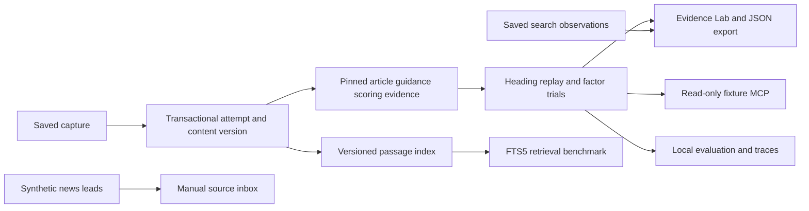

# Architecture

SEO Evidence Lab separates observations, versioned inputs, findings, and review decisions. The local demo explains a deterministic audit change while retaining uncertainty about search outcomes.

## Implemented components

| Area | Implementation | Inspect |
| --- | --- | --- |
| App and views | FastAPI and Jinja2 server-rendered UI | `seo_qa/web.py`, `seo_qa/competitor_web.py` |
| Capture history and replay | SQLite transactions, normalized content versions, four input pins and replay trials | `seo_qa/competitor.py` |
| General auditing | Versioned deterministic rules across five scopes | `seo_qa/scope_criteria.py` |
| Content assessment | Separate Bot-worthiness profile, reporting and local review routes | `seo_qa/botworthiness/` |
| Uploaded observations | Explicit upload contracts and graph/performance/rendering analysis | `seo_qa/upload_analysis.py` |
| Search measurements | Saved response normalization with exact request scope | `seo_qa/measurement.py` |
| Retrieval | SQLite FTS5 with passage/source/version identity | `seo_qa/evidence_search.py` |
| Source review | Local triage and retained decision history | `seo_qa/source_inbox.py` |
| Community leads | Bounded synthetic observations and provenance checks | `seo_qa/community_news.py` |
| Tools and evaluation | Three read-only MCP tools and fixture evaluation | `seo_qa/timeline_mcp.py`, `seo_qa/timeline_eval.py` |
| Local tracing | In-memory OpenTelemetry instrumentation | `seo_qa/fixture_trace.py` |

## Why the boundaries matter

A content version and a failed capture attempt are separate records. A failed capture does not become an empty replacement for the last good page. Audit IDs bind the four replay inputs; changing a rule or the evidence availability produces a different input identity.

Replaying one changed factor tests sufficiency within this deterministic fixture. It does not infer why a search engine changed rankings. Measurement scope and observation windows must match before comparison; missing observations stay unknown.

The local MCP server exposes known fixture evidence, comparison, and timeline reads over stdio. It does not provide remote account access or mutate guidance. The evaluation includes simulated judgments and makes that fact explicit.

The custom news agent and research/scraper remain external systems. The intended bridge normalizes their exports, retains source identity, and requests review before producing an immutable guidance release. See [news integration](../NEWS-INTELLIGENCE.md).

## Runtime and deployment

Python 3.12 and SQLite FTS5 run locally. Bootstrap installs the pinned dependency environment. The separately deployed protected demo contains inert static pages and saved JSON, with no dynamic backend. Do not treat that preview as production acceptance of the full app. [Operating scope](../SECURITY.md).
