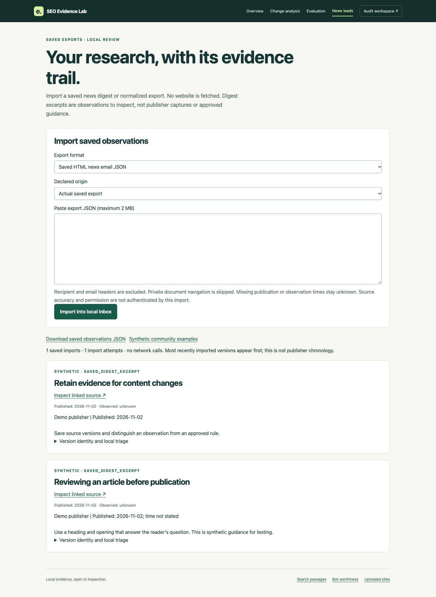

# Saved news agent bridge

The v0.2 development branch connects existing saved news-email exports to a local, versioned review inbox. It adds no crawler, provider credentials, model call, schedule, or paid dependency. v0.1.0 remains the stable tagged release.

## Reproduce with public synthetic examples

After the pinned environment is installed, `.venv/bin/python setup/news_bridge_demo.py` imports both saved synthetic versions and writes an inspectable `guidance-proposal.json` with exact source/import hashes, baseline audit pins and replay. It stays `proposed_unreviewed`, inactive, and without human approval. This is a proposal demonstration, not a news-to-approved-guidance acceptance claim.

Run `./walkthrough.sh` once to create the pinned environment. Then:

```sh
mkdir -p demo-output/news
.venv/bin/python -m seo_qa.news_bridge import --input fixtures/news-bridge/saved-email.json --db demo-output/news/inbox.sqlite --synthetic
.venv/bin/python -m seo_qa.news_bridge import --input fixtures/news-bridge/saved-email-revised.json --db demo-output/news/inbox.sqlite --synthetic
.venv/bin/python -m seo_qa.news_bridge report --db demo-output/news/inbox.sqlite
```

Start `./run-local.command`, open `/qa/community-news`, and follow **Open saved news inbox**. Paste a fixture JSON and choose **Synthetic demonstration**. A real saved export instead uses **Actual saved export**; that label is a declaration, not authentication of source truth.

The CLI database above is a separate demo database. The UI uses a private sidecar next to the selected app state, ending in `.news-inbox.sqlite`. Import through the UI if you want that dataset in the UI; the tool does not silently copy another database or read arbitrary server-side file paths.



## Accepted formats

**Saved digest email JSON:** an object with `payload.mime_type: "text/html"` and string `payload.body.content`. The adapter recognizes paragraph headline links and following excerpt paragraphs under section headings. It imports only supported public HTTPS source locators. Recipient/mail headers and private document-navigation links are excluded; email addresses repeated inside digest excerpts are minimized. It does not retain the original email or fetch linked pages.

**Normalized JSON:** `schema: "seo-news-export/v1"`, explicit boolean `synthetic`, and `items`. Each item supplies `url` and `title`, with optional `summary`, `topics`, `published_at`, `observed_at`, and `source_kind`. The declared synthetic value must match the import option. Source kind is `saved_digest_excerpt` or caller-declared `saved_page_capture`; the tool does not authenticate that declaration. Inputs are bounded to 2 MB and 200 items. Missing times remain null. A date-only publication value stays date-only; observation timestamps require an explicit timezone.

No article URL means no importable source observation: older digests containing only titles and a private running-document link are rejected, rather than assigned invented publisher URLs. The inspected local producer exports included four compatible files and one such rejection. Real excerpts and private input paths are not distributed with this repository.

## Storage and review

- Import identity binds the raw export hash, format, and declared synthetic origin. Exact retries are idempotent while retaining attempt history.
- Story identity binds the normalized URL, keeping query variants and independent publisher identities distinct. Fragment-only variants share a story; there is no semantic cross-publisher story clustering yet.
- Content/metadata changes create retained versions. A missing story in a later export never deletes earlier data.
- The inbox shows recent imported versions, not inferred publisher chronology. Older publications can arrive later. The view/report is bounded to 200 versions; the database retains the rest.
- Local accept-for-investigation, defer, and reject actions append decisions tied to an exact version. Actors are supplied declarations, not authenticated identities or independent editorial votes.
- No triage action publishes guidance or changes existing audit pins. Corroboration with primary captures and an approved immutable guidance release remain the next integration step.

## Proposal-only link to replay

The `propose` function and CLI action take an existing news version, caller-supplied audit inputs, an implemented heading rule, declared author, and explicit mapping reason. They bind the retained news version, source URL, original export hashes/import IDs, baseline audit identity/pins and proposed guidance hash into an immutable proposal. The replay shows the conditional effect of that supplied rule on the supplied audit inputs. It does not prove that the source is true, that the proposed mapping is justified, or that these are accepted stored audit records. Unsupported rules, unknown news versions, and missing reasons are refused. Exact proposals are idempotent.

No proposal publishes a knowledge release, mutates active rules, or changes an old audit. Real source corroboration, genuine approval and activation remain pending. Existing imports without the added provenance side table can be rebound by reimporting the exact original export; prior import/version identities remain unchanged.

Reports contain supplied excerpts and decision notes. Review them before sharing. Even a minimized digest is not a public-data clearance or an authenticated publisher capture.

## Verification

Twenty-four new offline cases exercise retries, version retention, invalid/oversized input, missing/contradictory timestamps, duplicate JSON keys, recipient-footer minimization, unsafe locators, CSRF, HTML escaping, CLI readback, hosted-route refusal, and source-bound proposal replay without activation. They are included in the portable fixture workflow. Browser acceptance runs with installed Chrome:

```sh
.venv/bin/python setup/news_bridge_acceptance.py --output demo-output/news/browser
```

It imports synthetic data through the form, records an explicitly synthetic triage declaration, downloads JSON, checks desktop/mobile layouts, and actually restarts the process to verify persistence. No live collection or human acceptance is inferred.
